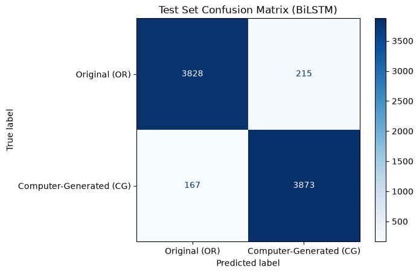
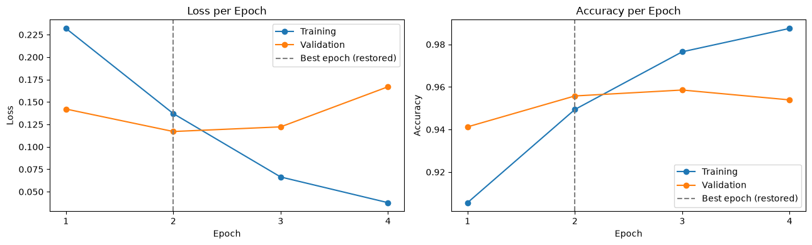

# Fake Product Review Detection

[](https://colab.research.google.com/github/modecode22/fake-product-review-detection/blob/main/Fake_Product_Review_Detection.ipynb)

An NLP project that uses a Bidirectional LSTM to classify product reviews as computer-generated or original human-written reviews.

## Project Overview

Online shoppers use product reviews to help make purchasing decisions. This project explores how Natural Language Processing (NLP) and deep learning can classify review text into two dataset labels: computer-generated (CG) and original (OR).

## Repository Structure

| Path | Description |
|---|---|
| `Fake_Product_Review_Detection.ipynb` | The full, explained workflow: data checks, preprocessing, baseline, BiLSTM training, evaluation |
| `predict.py` | Command-line script that classifies new reviews with the saved model |
| `artifacts/` | Trained model (`.keras`), fitted tokenizer and prediction settings |
| `requirements.txt` | Python dependencies with the versions used for the saved run |

## Dataset

The dataset contains product review text, product category, rating, and label.

- `CG`: Computer-generated review
- `OR`: Original human-written review

It has 40,432 reviews, 20,216 per class, across 10 product categories.

The CSV is **not stored in this repository**. The notebook downloads it automatically from the source repository, pinned to a fixed commit, and verifies its SHA-256 checksum:

- File: [`fake reviews dataset.csv`](https://github.com/SayamAlt/Fake-Reviews-Detection/blob/69f5120d143f8744df3a1596d8d11be5ac76b504/fake%20reviews%20dataset.csv)
- SHA-256: `ea03422988824bc917b5f7217e3867e27b597c647d5261adfae73cd7a85e1e1a`

To use a local copy instead, place it at `data/fake reviews dataset.csv`.

The dataset labels distinguish computer-generated text from original human-written text. They do not necessarily identify paid, deceptive, or fraudulent reviews.

## Method

1. Downloaded the dataset, verified its checksum and inspected it.
2. Removed 20 duplicate review texts so the same review cannot appear in both training and test data.
3. Converted labels to numeric values: `CG = 1` and `OR = 0`.
4. Cleaned review text lightly: lowercased it and separated punctuation into its own tokens. Stopwords and punctuation are **kept**, because the notebook shows that removing them lowers accuracy.
5. Split the data into training, validation and test sets (72% / 8% / 20%, stratified).
6. Trained a TF-IDF + Logistic Regression baseline for comparison.
7. Tokenized the text with a 20,000-token vocabulary fitted on the training set only, and padded each review to 300 tokens.
8. Trained a Bidirectional LSTM classifier with early stopping on the validation loss.
9. Evaluated the model once on the held-out test set.
10. Saved the model, tokenizer and settings, then reloaded them to classify new reviews.

## Model

The model uses an embedding layer (with padding masked), a Bidirectional LSTM layer, a dense layer with dropout, and a sigmoid output for binary classification. It is trained with the Adam optimizer and binary cross-entropy loss, using early stopping on the validation loss.

## Results

Results on the held-out test set (8,083 reviews):

| Model | Test accuracy |
|---|---|
| TF-IDF + Logistic Regression (baseline) | 94.31% |
| **Bidirectional LSTM** | **95.27%** |

Bidirectional LSTM, per class:

| Class | Precision | Recall | F1-score |
|---|---|---|---|
| Original (OR) | 0.958 | 0.947 | 0.953 |
| Computer-Generated (CG) | 0.947 | 0.959 | 0.953 |



Validation loss is lowest at epoch 2 and rises afterwards, so early stopping restores the epoch 2 weights:



An earlier version of this notebook removed stopwords and punctuation and reported 90.76% test accuracy. The baseline comparison in the notebook shows that this cleaning choice alone costs about 4.5 points of validation accuracy (90.1% against 94.7%).

## How to Run

### Google Colab

1. Click the **Open in Colab** badge above.
2. Run all cells. The dataset is downloaded automatically.

### Locally

Tested with Python 3.11.

```bash
pip install -r requirements.txt
```

```bash
jupyter notebook Fake_Product_Review_Detection.ipynb
```

### Classify your own reviews

The trained model is included, so this works without retraining:

```bash
python predict.py "Great product, works exactly as described."
```

The output is the predicted label and the probability that the review is computer-generated.

## Reproducibility

The notebook fixes one random seed for Python, NumPy and TensorFlow, and the data split is seeded. Re-running on the same hardware and library versions reproduces the saved results. Small differences are expected between CPU and GPU or between TensorFlow versions.

## Limitations

This model detects computer-generated review text as represented in this dataset. It is not a general-purpose detector of every type of fake, paid, or fraudulent product review. The computer-generated reviews in the dataset come from an older text generator, so performance may not carry over to reviews written by newer AI models or to other review platforms.

## Attribution

Dataset source: [SayamAlt/Fake-Reviews-Detection](https://github.com/SayamAlt/Fake-Reviews-Detection)

Original dataset paper: Salminen, J., Kandpal, C., Kamel, A. M., Jung, S., & Jansen, B. J. (2022). Creating and detecting fake reviews of online products. *Journal of Retailing and Consumer Services*, 64, 102771. https://doi.org/10.1016/j.jretconser.2021.102771

This repository is a fork of [Renad968/fake-product-review-detection](https://github.com/Renad968/fake-product-review-detection).
